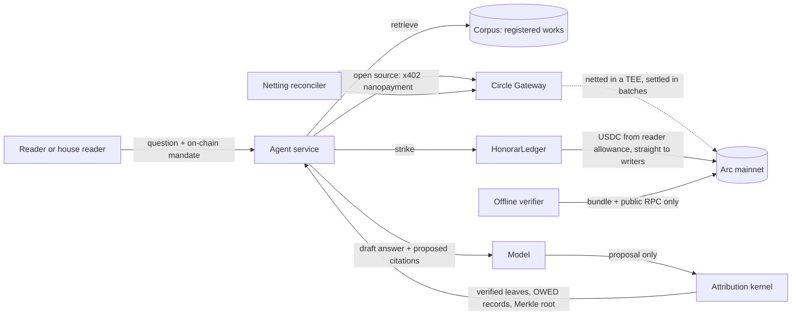

# ARCHITECTURE

## Components

- `contracts/src/HonorarRegistry.sol`: works, content hashes, prices, co-author splits, versions. Holds no money.
- `contracts/src/HonorarLedger.sol`: mandates, once-only strikes, Merkle root recomputed on chain, 2.5% fee leg. Moves money straight from the reader allowance. Holds no money.
- `packages/kernel`: pure TypeScript. Normalization, citation verification, completeness sweep, leaves, Merkle, bundle.
- `packages/verifier`: checks V1 to V9 over a `ChainReader` interface. CLI and browser.
- `packages/chain`: ABIs, addresses, typed reads, unit helpers.
- `services/agent`: Hono API. Seller (`/read/:workId`), buyer with caps and payee pinning, reconciler, answer loop with SSE, bundle store.
- `apps/web`: Next.js app, landing story, app pages, verify and proof.

## Money boundaries

The model returns an order and a proposal. Prices come from the registry snapshot. The ledger re-reads price and version on chain, so a forged amount reverts.
