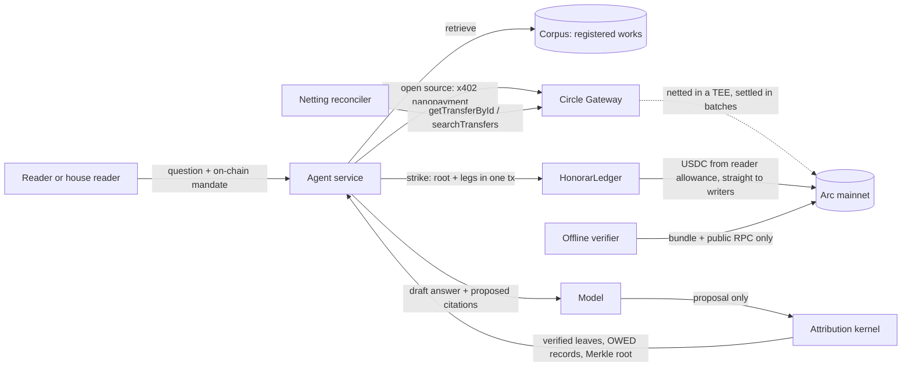

# Honorar

**Honorar pays writers every time an AI quotes them, and shows them the exact sentence that earned it.**

Per-stream royalties, for the words AI reads. Settled in USDC on Arc.

  

Honorar is a registry, a ledger and a deterministic attribution kernel. A model proposes which sources it quoted. Code decides which quotes are real and used. One Arc transaction commits the Merkle root and pays the writers. Anyone can re-derive every check from a bundle and a public RPC.

## Product links

| | |
|---|---|
| Live app | set after Vercel deploy (see PROGRESS.md) |
| Verify an answer | `/verify` |
| Proof | `/proof` |
| Ledger | `/app/ledger` |
| Contracts | see [EVIDENCE.md](EVIDENCE.md) |
| Repository | github.com/0xkinno/honorar |

## The problem

Ifeoma writes deep explainers on stablecoins. Assistants clearly read her, she sees her phrasing in their answers, and she has never been paid once or been able to prove which sentences were used. When someone does pay, it is a monthly lump from a formula nobody can check.

## The solution

She registers an article once. Every time an agent opens it she earns a reading fee, and every time an answer quotes her she earns an honorarium. Her Earnings page lists each quote, the exact sentence, the answer it went into and the Arc transaction that paid her.

## Explore it in 2 minutes

1. Open `/app/ask` and ask without a wallet (house reader).
2. Watch the stream: reads, kernel verdicts, strike.
3. Press "Verify this answer". The verifier runs in your browser against an Arc RPC.

## What we found on Arc

Circle Gateway nets nanopayments inside a TEE and settles them in batches, so an individual reading fee never appears on chain. Honorar records each transfer id, walks it through `received`, `batched`, `confirmed`, `completed`, and reconciles the batch. Measured numbers live in [DISCOVERY.md](DISCOVERY.md) and `evidence/discovery/`. Anything not measured yet is marked UNKNOWN there.

## How it works



```
 READ  (sub-cent, netted)                      QUOTE  (per sentence, struck)
 agent opens an article                         answer quotes two sentences
   | x402: sign EIP-3009, zero gas               | kernel: in source? used in answer?
   v                                              v
 Gateway: lock buyer, credit pending            Merkle leaf per verified quote
   v                                              v
 TEE nets everyone, one Arc tx                  HonorarLedger.strike(): reader -> writers
   v                                              v
 reconciler un-nets it                          receipt: sentence + leaf + tx
```

## The guarantee and the twelve invariants

No writer is paid for words the AI did not use. No quoted words go unpaid. Every cent reconciles to Arc. See [INVARIANTS.md](INVARIANTS.md) for each rule, its test and its verifier check.

## Break campaign

Generated by `pnpm break` into `evidence/break/`. Summary in [PROOF.md](PROOF.md).

## Relevance to Arc

- USDC is the gas token, so a strike costs cents and is quoted in dollars. The 18 decimal native view and the 6 decimal ERC-20 view are kept apart in code (`packages/chain/src/units.ts`).
- Deterministic finality: an honorarium is final in one block.
- Gateway nanopayments on Arc mainnet carry the reading fees.
- ERC-8004 identity and reputation registries on Arc mainnet identify the agent and record per-answer feedback.

## Technical credibility

- Pure TypeScript kernel with unit, property and golden-vector tests shared with Foundry.
- Foundry suite with fuzz and invariant tests.
- Offline verifier (CLI and browser) that needs only the bundle and an Arc RPC.
- Reproduce: `pnpm install && pnpm -r test && (cd contracts && forge test) && pnpm break`.

## Quality of what we built

Editorial UI on paper-white with violet glass, a pinned scroll story, two-clock settlement view, and a nine viewport Playwright matrix (results in `evidence/qa.json`).

## Worth taking further

Writer claim flow for OWED balances, publisher plugins, an agent SDK and MCP server, multi-span pricing, in-app Gateway withdrawal.

## What's new

Honorar continues an earlier testnet prototype by the same builder. Everything in this repository was rebuilt for Arc mainnet: new contracts, the attribution kernel, the Gateway rail and reconciler, the verifier, the benchmark harness and the UI.

## What we got wrong, and fixed

The earlier prototype claimed a reading fee "settled in under half a second" at the moment the payment call returned. That value was an authorization, not a settlement. Honorar now shows four states and never says "paid" before `completed`.

## Target user, business model

Writers and the agents that read them. A 2.5% protocol fee leg is added on top of each honorarium and sent to the treasury in the same transaction. Writers keep 100% of their registered price.

## Limitations

See [LIMITATIONS.md](LIMITATIONS.md).

## Security

See [SECURITY.md](SECURITY.md).

## Local setup

```bash
pnpm install
node scripts/gen-wallets.mjs        # writes .env.local, gitignored
cd contracts && forge install foundry-rs/forge-std --no-git && forge test
pnpm --filter @honorar/agent start  # agent API on :8787
pnpm --filter @honorar/web dev      # web on :3000
```

## Repository map

`apps/web`, `services/agent`, `packages/kernel`, `packages/verifier`, `packages/chain`, `contracts`, `scripts`, `evidence`, `docs`.

## Credits

Typography: Geist, Geist Mono, Instrument Serif. Built by 0xkinno.
