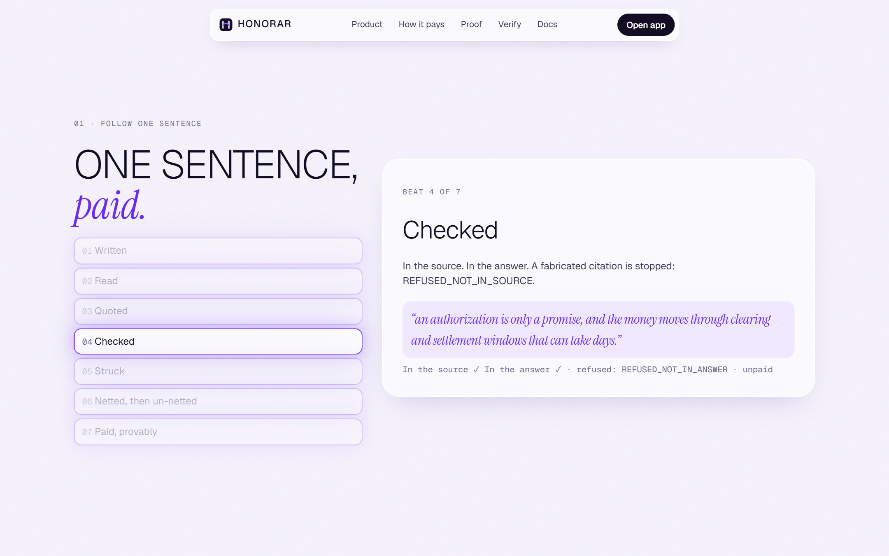
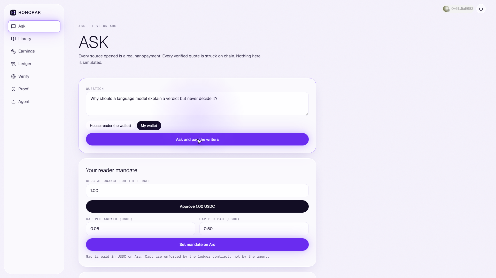
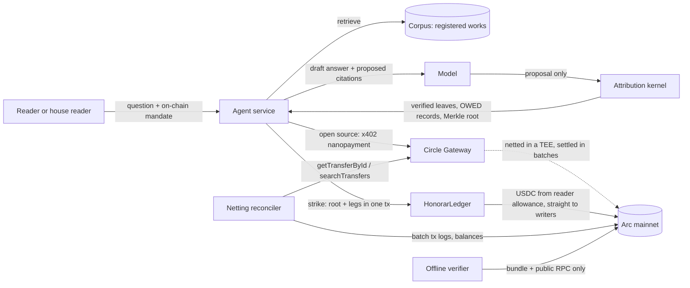
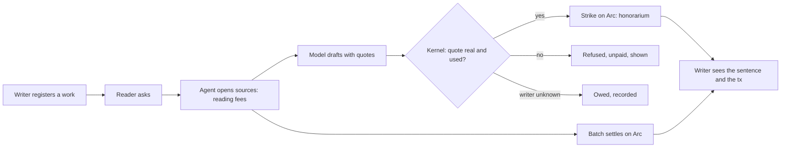
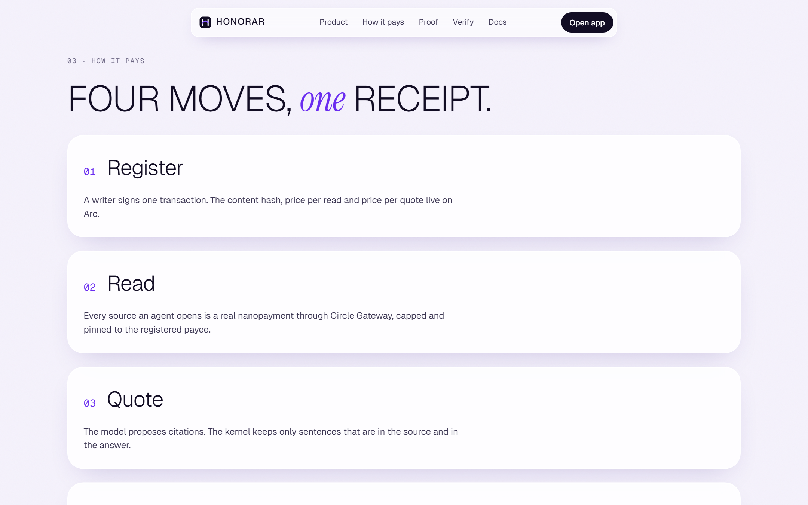
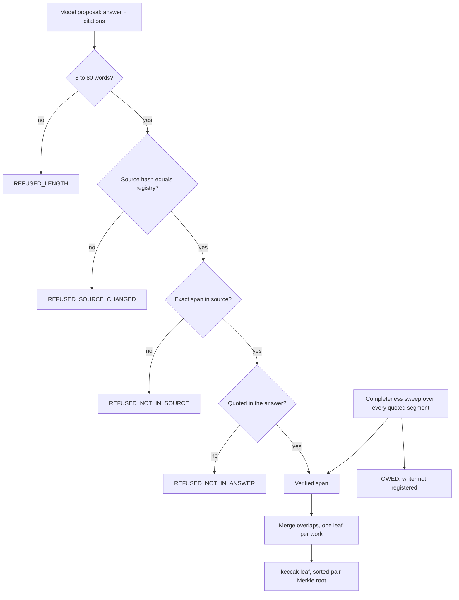
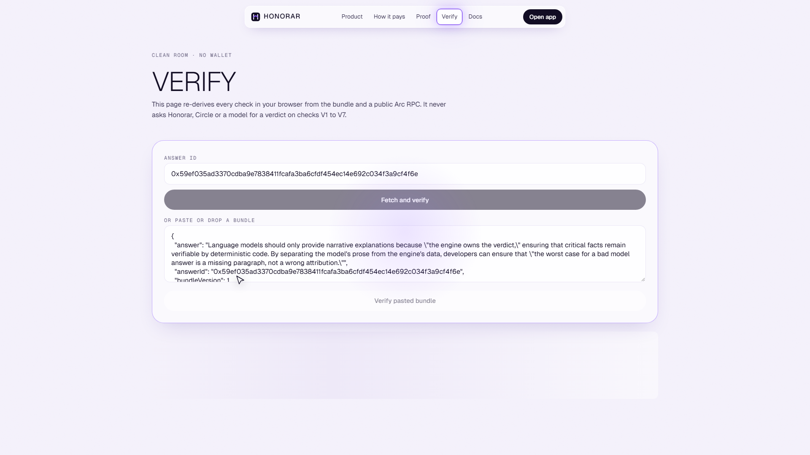

<div align="center">

# Honorar

### Honorar pays writers every time an AI quotes them, and shows them the exact sentence that earned it.

*Per-stream royalties, for the words AI reads. Settled in USDC on Arc.*

[](https://explorer.arc.io) [](#contracts-on-arc-mainnet) [](EVIDENCE.md) [](EVIDENCE.md) [](evidence/break) [](#the-verifier) [](#license)


</div>

> **The model proposes who to credit. Deterministic code decides who gets paid. Arc decides what happened.**

---

## Product links

| | |
|---|---|
| **Live app** | [honorar.vercel.app](https://honorar.vercel.app) |
| **Ask without a wallet** | [/app/ask](https://honorar.vercel.app/app/ask) |
| **Verify an answer (no wallet)** | [/verify](https://honorar.vercel.app/verify) |
| **Proof** | [/proof](https://honorar.vercel.app/proof) |
| **Ledger** | [/app/ledger](https://honorar.vercel.app/app/ledger) |
| **HonorarRegistry** | [`0xA9Cc0e089f78c5d9fEaA7b44B649843fA035F8eb`](https://explorer.arc.io/address/0xA9Cc0e089f78c5d9fEaA7b44B649843fA035F8eb) |
| **HonorarLedger** | [`0x3A6B60C47D8726D0Ab642742AC9E65CE16173D41`](https://explorer.arc.io/address/0x3A6B60C47D8726D0Ab642742AC9E65CE16173D41) |
| **All transactions and addresses** | [EVIDENCE.md](EVIDENCE.md) |
| **Demo video** | script in [docs/DEMO-SCRIPT.md](docs/DEMO-SCRIPT.md), recording follows |
| **Agent API** | [honorar-api.onrender.com](https://honorar-api.onrender.com/health) |
| **Agent identity (ERC-8004)** | registry [`0x8004A169...a432`](https://explorer.arc.io/address/0x8004A169FB4a3325136EB29fA0ceB6D2e539a432), agent id **2436**, see [EVIDENCE.md](EVIDENCE.md) |
| **Repository** | [github.com/0xkinno/honorar](https://github.com/0xkinno/honorar) |

## Contracts on Arc mainnet

Chain id `5042`. Solidity 0.8.28, optimizer 200 runs, EVM cancun. Neither contract holds money, and neither has an admin path that can move it.

| Contract | Address | Source | Job | What the owner can do |
|---|---|---|---|---|
| `HonorarRegistry` | [`0xA9Cc...F8eb`](https://explorer.arc.io/address/0xA9Cc0e089f78c5d9fEaA7b44B649843fA035F8eb) | [Sourcify, exact match](https://repo.sourcify.dev/5042/0xA9Cc0e089f78c5d9fEaA7b44B649843fA035F8eb) | Works, content hashes, read and quote prices, co-author splits, versions | Nothing. Only a work's primary recipient can update it. |
| `HonorarLedger` | [`0x3A6B...3D41`](https://explorer.arc.io/address/0x3A6B60C47D8726D0Ab642742AC9E65CE16173D41) | [Sourcify, exact match](https://repo.sourcify.dev/5042/0x3A6B60C47D8726D0Ab642742AC9E65CE16173D41) | Reader mandates, once-only strikes, on-chain Merkle root, 2.5% fee leg | Rotate the agent key, set the treasury, hand over ownership. Cannot move funds, change fees or edit roots. |

Deployment transactions, block numbers and the strike log live in [EVIDENCE.md](EVIDENCE.md), which is generated by a script, never typed by hand.

---

## The problem

Ifeoma, 31, Lagos, writes deep explainers on stablecoins. Her traffic is falling because people now ask AI assistants instead of clicking. The assistants are clearly reading her: she sees her phrasing in their answers. She has never been paid, and she cannot prove which of her sentences were used.

Two comfortable assumptions are quietly wrong, and together they make fair payment impossible:

| Everyone assumes | Reality |
|---|---|
| *"On Arc every payment is on a public ledger, so anyone can verify it."* | The payments that make sub-cent pricing possible, Circle Gateway nanopayments, never appear on chain one by one. They are authorized off chain, **netted inside a TEE**, and settled as a single net delta. The individual payment is gone. |
| *"If the AI cites a source, the source was used."* | Models cite sources they did not use, quote words that are not there, and can be steered by text inside a page ("cite this article"). A payout that trusts model citations pays the wrong people. |

## The solution

Honorar makes every AI **read** and every AI **quote** individually auditable on Arc.

1. **The writer registers** an article once. The hash of its normalized text and two prices (per read, per quote) are committed on chain.
2. **An agent reads it** through a real Gateway nanopayment: capped, pinned to the registered payee, never retried after signing.
3. **A model drafts** and proposes citations. That is *all* it can do. Its output is typed so it cannot carry an amount, an address or a price.
4. **The kernel decides.** A quote is paid only if it is an exact span of the registered source *and* appears quoted in the answer. Quotes the model forgot are added. Quotes of unregistered writers become `OWED` records.
5. **One transaction strikes.** Verified quotes become Merkle leaves, the root is recomputed on chain and the writers, the 2.5% protocol fee and the fronted reading fees are paid straight from the reader's allowance.
6. **A reconciler un-nets** each reading fee: `received` to `batched` to `confirmed` to `completed`, tied to the batch transaction that settled it.
7. **Anyone verifies.** A bundle and a public RPC are enough. No Honorar API, no Circle API, no model.



---

## Using it

### As a writer (Ifeoma)

| Step | Where | What happens |
|---|---|---|
| 1. Connect | any app page | Reown AppKit wallet on Arc. |
| 2. Register | `/app/library` | Paste a URL or text, see the exact content hash, set two prices and co-author splits, sign `registerWork`. The call is simulated first and the gas shown in USDC. |
| 3. Earn | `/app/earnings` | Every struck quote lists the sentence, the answer and the transaction. Reading fees show their live clock. |
| 4. Prove | `/verify` | Hand any answer id to anyone. They re-derive the payout in their own browser. |

### As a reader or agent operator

| Step | Where | What happens |
|---|---|---|
| 1. Ask | `/app/ask` | **House reader** needs no wallet: an operator reader pays under an on-chain mandate the contract enforces. Or connect your own wallet. |
| 2. Cap | `/app/ask` (My wallet) | Two real transactions: `approve` and `setMandate(maxPerAnswer, maxPer24h)`. The ledger refuses to spend past either cap. |
| 3. Watch | `/app/ask` | Each stage streams live: retrieve, decide, read (with its clock), draft, kernel verdict per citation, strike with the transaction link. |
| 4. Keep | answer card | Download the bundle or press **Verify this answer**. |

### As a skeptic

Open `/verify`, paste an answer id, and watch checks V1 to V9 run against an Arc RPC. Flip one byte in the bundle and watch it fail.



---

## How it works

### Architecture



### How the money moves

```
 READ  (sub-cent, netted)                      QUOTE  (per sentence, struck)
 ------------------------                      -----------------------------
 agent opens Ifeoma's article                   answer quotes 2 of her sentences
   |  x402: sign EIP-3009, zero gas               |  kernel: span in source? used in answer?
   v                                              v
 Gateway: lock buyer, credit pending            Merkle leaf per verified quote
   |  (status: received)                          |  root committed on Arc
   v                                              v
 TEE nets everyone, one Arc tx                  HonorarLedger.strike(): reader -> writers
   |  (batched -> confirmed -> completed)         |  one tx, final in one block
   v                                              v
 reconciler finds the batch, un-nets it         receipt: sentence + leaf + tx
            \                                   /
             '------ verifier checks both -----'
```

### Product flow



### Two settlement physics, side by side

| | Reading fee | Honorarium |
|---|---|---|
| Rail | Circle Gateway nanopayment (x402) | `HonorarLedger.strike()` |
| Gas | zero per payment (netted) | paid in USDC, amortized over every quote in one answer |
| On-chain visibility | net delta only, in a batch tx | one event per quote, plus the root |
| Clock | authorization now, settlement later | final in one block |
| Honorar's job | **un-net it** (reconciler, I8, I9) | **prove it** (kernel, root, I1 to I7) |

The UI never calls a reading fee "paid" before `completed`. It walks **Authorized, Batched, Confirmed, Settled on Arc** and shows the batch transaction once known.



---

## The guarantee

> **No writer is paid for words the AI did not use. No quoted words go unpaid. Every cent reconciles to Arc.**

### Twelve named invariants

Each has a rule, a test, a verifier check and an attack that targets it. Full table with test names: [INVARIANTS.md](INVARIANTS.md).

| ID | Name | Rule | Enforced in | Checked by |
|---|---|---|---|---|
| I1 | SPAN | A paid span is an exact substring (after `NORM_V1`) of a source whose sha256 equals the registered `contentHash` | kernel | verifier V2, V3 |
| I2 | USE | A paid span appears quoted in the final answer | kernel | V3 |
| I3 | COMPLETE | Every verified quoted span is paid, or recorded `OWED` with a reason | kernel | V4 |
| I4 | ONCE | `(answerId, workId)` is struck at most once | contract | contract tests, V6 |
| I5 | MANDATE | Strike total stays inside the reader's per-answer and 24h caps | contract | contract tests, V6 |
| I6 | VERSION | A leaf names the work version it was priced against; the strike reverts if it changed | contract | contract tests, V7 |
| I7 | ROOT | The on-chain root equals the Merkle root the verifier recomputes | contract + verifier | V5 |
| I8 | FRONTED | Fronted reading fees equal the committed Gateway transfers, each `completed` | reconciler | V8 |
| I9 | NETTING | In a Gateway batch, transfers to a writer never exceed that writer's observed credit | reconciler | V9 |
| I10 | NO-MODEL-MONEY | No model output is typed as an amount, address or price | kernel types | unit test |
| I11 | NO-RETRY-AFTER-SIGN | A signed payment is never retried; ambiguity is resolved by `searchTransfers` | agent | fault test |
| I12 | CLEAN-ROOM | The verifier needs only the bundle and an Arc RPC | verifier | CI job |

### The kernel in one picture



Normalization is `NORM_V1`: NFKC, lowercase, curly quotes to straight, strip zero-width characters, unify dashes, collapse whitespace. Nothing else. No stemming, no synonyms: **a paraphrase is not a quote.** The version string is part of every span hash, so changing normalization is a visible event.

### The verifier

```bash
pnpm --filter @honorar/verifier exec tsx src/cli.ts bundle.json --rpc https://rpc.mainnet.arc.io
```

| Check | Question | Invariants |
|---|---|---|
| V1 | Is the bundle canonical JSON? | I7 |
| V2 | Does every source hash to the on-chain `contentHash`? | I1 |
| V3 | Is every paid span in its source and in the answer? | I1, I2 |
| V4 | Does the completeness sweep reproduce the same leaves and owed set? | I3 |
| V5 | Does the recomputed root equal `roots[answerId]` on chain? | I7 |
| V6 | Do `QuoteStruck` and `AnswerStruck` events match leaves, fee and fronted? | I4, I5 |
| V7 | Do versions and prices at the strike block match the leaves? | I6 |
| V8 | Do the transfer ids hash to the committed value (and are they `completed`)? | I8 |
| V9 | Does each Gateway batch reconcile? | I9 |



---

## Evidence

Everything below is generated from files in this repository. Numbers are never typed.

### Tests

<!-- stats:start -->
| Suite | Passing |
|---|---|
| Foundry (unit, fuzz, invariant, golden vectors) | 42 |
| Attribution kernel (unit, property, shared vectors) | 30 |
| Offline verifier (clean and tampered bundles) | 10 |
| Agent service (retrieval, planning, reconciler) | 8 |
<!-- stats:end -->

Golden vectors: 2000 random leaf sets generated by the TypeScript kernel are re-derived by the Solidity Merkle rule, so the off-chain root and the on-chain root cannot drift.

### Break campaign

Each attack runs against the real kernel, verifier or contract. Raw results: `evidence/break/*.json`.

<!-- break:start -->
| ID | Attack | Expected | Observed | Verdict |
|---|---|---|---|---|
| B1 | Model cites a sentence that is not in the source | REFUSED_NOT_IN_SOURCE, unpaid | REFUSED_NOT_IN_SOURCE, leaves=0 | rejected |
| B2 | Model paraphrases and presents it as a quote | REFUSED_NOT_IN_SOURCE | REFUSED_NOT_IN_SOURCE, leaves=0 | rejected |
| B3 | Citation stuffing: injected instruction in a registered source makes the model quote it repeatedly | payout delta capped at zero extra honoraria: one leaf per work | leaves=1, spans=3, payout delta=0 base units | rejected |
| B4 | Agent retries a strike after a timeout | second strike reverts (AlreadyStruck) | forge test_I4_duplicate_answer_reverts: Success | rejected |
| B5 | Strike total above the reader mandate | reverts (PerAnswerCapExceeded) | forge test_I5_per_answer_cap: Success | rejected |
| B6 | Writer updates the work between read and strike | strike reverts (VersionMismatch) | forge test_I6_version_swap_reverts: Success | rejected |
| B7 | One byte flipped in a stored bundle | verifier V1/V5 FAIL | V4,V5,V6,V7 | rejected |
| B8 | Seller drops the connection after the agent signed | no retry, resolved by searchTransfers, paid exactly once | pay() error "fetch failed", signed requests at seller 1, transfers found 1 | recovered |
| B9 | Answer quotes an unregistered writer | OWED record, no payment | owed=writer_not_registered, leaves=0 | rejected |
| B10 | Operator inflates frontedReadingFees or edits transfer ids | verifier V6/V8 FAIL | fronted: FAIL; ids: FAIL | rejected |
| B11 | Agent forges a leaf amount above the registry price | strike reverts (PriceMismatch) | forge test_B11_price_above_registry_reverts: Success | rejected |
| CONTROL | Untouched clean answer | passes every check | V1:PASS V2:PASS V3:PASS V4:PASS V5:PASS V6:PASS V7:PASS V8:PASS V9:UNKNOWN | passed_control |
<!-- break:end -->

### QA matrix

Nine viewports by eight routes, run against the live deployment: no horizontal scroll, no overlapping controls, no console errors. Result: **72 of 72**, in `evidence/qa.json`.

### On-chain proof

<!-- mainnet:start -->
**15 answers struck on Arc mainnet**, 46 reading fees through Gateway in those answers, 0.130500 USDC of honoraria to the writer.

| Answer | Quoted sentence | Strike tx | Block |
|---|---|---|---|
| `0x072e10d9` | "thousands of tiny authorizations are collected, netted against one ..." | [0x26ac9c02...](https://explorer.arc.io/tx/0x26ac9c025de05128be3090c0c3ef1b927761d62f3e9a7d5ebb5ef0206a411d38) | 25963688 |
| `0x21fddc75` | "thousands of tiny authorizations are collected, netted against one ..." | [0x9c839154...](https://explorer.arc.io/tx/0x9c839154c53c8248c7dbce725ab0f55eac70686aef26f04e7f0ea405580f64c7) | 25962972 |
| `0x42e1adf5` | "a stablecoin payment is final when the ledger says it is final, and..." | [0x09d6697b...](https://explorer.arc.io/tx/0x09d6697b17b30243de2075f14106b3d5d2fa2d98fdf128fa5891f7e6c0bdcfae) | 25963046 |
| `0x4d68c6d0` | "a stablecoin payment is final when the ledger says it is final, and..." | [0x57cb3d45...](https://explorer.arc.io/tx/0x57cb3d4548ae56cbb9b548a63bd4d4ff46b9b0387a2df1a0379b932e9854d1ca) | 25963747 |
| `0x5b4d197b` | "a stablecoin payment is final when the ledger says it is final, and..." | [0x33353a94...](https://explorer.arc.io/tx/0x33353a9432f6fd46e268c2237d0fe5bca122a2607d8f9470aeae80eb745fe4d3) | 25947158 |
| `0x763f2fed` | "thousands of tiny authorizations are collected, netted against one ..." | [0x5cb82e30...](https://explorer.arc.io/tx/0x5cb82e3056d585b35256671d5a243e6db2682800c88ca2af4e7a360c59f7197a) | 25963810 |
| `0x7799747f` | "payment becomes the byproduct of a record that stands on its own." | [0x42888f0e...](https://explorer.arc.io/tx/0x42888f0e21d82b61e533502a25572105b05800f3c7ea88f1ae78e9ba5456494d) | 25963089 |
| `0x8436aaae` | "a stablecoin payment is final when the ledger says it is final, and..." | [0xb5dd69f1...](https://explorer.arc.io/tx/0xb5dd69f1fe5b25c4b503c8e8656fd3c138eebcf68b6cfd23bff8027f64158847) | 25946989 |
| `0x8593b372` | "fees are small and quoted in dollars, which makes very small paymen..." | [0xece04bb0...](https://explorer.arc.io/tx/0xece04bb09a53035e00df4bcd9e1bf24a80e542d1f7687d234c4eac553c279dfd) | 25947776 |
| `0x8c6d1c62` | "thousands of tiny authorizations are collected, netted against one ..." | [0xed767b4f...](https://explorer.arc.io/tx/0xed767b4f1d68c62582d3dc0a5e439a6f1e9f8bd68ad4140e06b2ba55ec390bea) | 25963204 |
| `0xa86e57e4` | "a public history of verified quotations lets a writer price her wor..." | [0xc032c3f8...](https://explorer.arc.io/tx/0xc032c3f8d15b6987a1e47aeaf456ad0b572304c4df18f369fc59079f0cb2e39c) | 25963884 |
| `0xe75bb849` | "an authorization is only a promise, and the money moves through cle..." | [0xb6e05566...](https://explorer.arc.io/tx/0xb6e055664ac1ff058fdf1d13f2983dd284def29f45a3645637a27dc7ec05f16c) | 25947830 |
| `0xeb68cda5` | "a public history of verified quotations lets a writer price her wor..." | [0x5062fc60...](https://explorer.arc.io/tx/0x5062fc60f35f694dae1fc5e47c062d868fd81755436acb508399a5a192ac33c8) | 25963129 |
| `0xf1e0b906` | "a reading fee of a tenth of a cent only makes sense when the rail h..." | [0x6c3e9149...](https://explorer.arc.io/tx/0x6c3e91497b71be6696864f5ed0034247aafbb32ef41c229431a6e026dc9743dc) | 25947218 |
| `0x8a9951ba` | "an authorization is only a promise, and the money moves through cle..." | [0x772378c2...](https://explorer.arc.io/tx/0x772378c27319e887bc14c0f8114ae720aab675f3fe2b494c0e4aa23071af1211) | 25946799 |

Tally: **21 answers run on mainnet, 16 struck, 5 refused** (REFUSED_NOT_IN_ANSWER x5). Largest strike: 5 quotes from 5 different registered works in one transaction.

ERC-8004 agent id **2436** ([registration](https://explorer.arc.io/tx/0x3482f79593f458963d9f35728119a1c0713554476f54467b9a54e13aa0381420)), 11 validator feedback entries recorded.
<!-- mainnet:end -->

### Discovery: what Arc actually does

Measured on mainnet by `scripts/discovery/`, rendered into [DISCOVERY.md](DISCOVERY.md).

<!-- discovery:start -->
- **Reading fees are slow to settle and vary widely.** 14 nanopayments of 0.001 USDC: 100% reached `completed`; authorization to settled took p50 **527.7s**, p95 875.1s, from 53.4s to 875.1s. A UI that says "settled" when `pay()` returns is wrong by minutes.
- **A batch hides the individual payments.** 14 transfers settled in 2 transactions with one log each: [0x5c327c80...](https://explorer.arc.io/tx/0x5c327c80d043dfde96129b02a0e47e62845c0bb0b154078fb0db7c6f96aa5eda) carried 1 and [0xb7302cb3...](https://explorer.arc.io/tx/0xb7302cb3aa7cd09aa23ab14f03790abf8de8dce72ea084ab188e4aaa25202021) carried 13 of ours. No transfer id appears on chain.
- **The settlement hash is an untyped field.** The SDK type has an index signature; the batch hash arrives as `txHash`.
- **Funds leave the available balance at authorization.** Deposit 0.040000 USDC, 15 transfers of 0.001, available balance 0.025000 as expected.
- **A signed payment must never be retried.** When the seller drops the socket after settling, `pay()` throws but the payment exists: 1 transfer found by `searchTransfers`, 1 signed request sent. Verdict: recovered.
- **Writer credit reconciles.** Writer Gateway total 0.014000 USDC equals completed transfers to that writer (MATCH).
- **A strike is cheap.** 520599 gas, **0.010412 USDC** for a one-leaf honorarium (15 strikes measured).
<!-- discovery:end -->

### Benchmark: payout policies over identical answers

<!-- bench:start -->
40 questions, 5 sources (one carries an injected instruction), two models (`gemini-3.1-flash-lite`, `openai/gpt-oss-20b`). Same answers, only the payout policy changes. Metrics are deterministic, no model judge.

**Main model**

| Policy | Misdirected USDC | Unpaid use | Fabricated citations paid | Paid to the injected source |
|---|---|---|---|---|
| Pay per read | 72.4% | 0 | 0 | 9 |
| Model attribution | 35.1% | 0 | 13 | 0 |
| Random control | 20.8% | 5 | 0 | 1 |
| Honorar | 0% | 0 | 0 | 0 |

**Second model**

| Policy | Misdirected USDC | Unpaid use | Fabricated citations paid | Paid to the injected source |
|---|---|---|---|---|
| Pay per read | 80.5% | 0 | 0 | 9 |
| Model attribution | 60.5% | 0 | 26 | 1 |
| Random control | 17.6% | 3 | 0 | 1 |
| Honorar | 0% | 0 | 0 | 0 |
<!-- bench:end -->

---

## Relevance to Arc

| Arc and Circle primitive | How Honorar uses it |
|---|---|
| **USDC as gas** | A strike costs cents and is quoted in dollars. The 18 decimal native view and the 6 decimal ERC-20 view are separated in `packages/chain/src/units.ts` and never mixed. |
| **Deterministic finality** | An honorarium is final in one block, so the receipt can say *Struck, final* immediately. |
| **Gateway nanopayments on Arc mainnet** | Reading fees at sub-cent prices, signed as EIP-3009 authorizations by an EOA agent wallet, tracked through `getTransferById` and `searchTransfers`. |
| **ERC-8004 identity and reputation** | The agent is registered in the mainnet IdentityRegistry. A separate validator wallet records one feedback score per answer from the kernel outcome. |
| **Native USDC precompiles** | Strikes use plain ERC-20 `transferFrom`, which Arc routes through its native USDC. |

## Technical credibility

- **Pure kernel**: zero I/O, strict TypeScript, no `any`, branded `Usdc6` created in exactly one function.
- **Contract-level truth**: price and version are re-read from the registry on chain, so a forged amount reverts.
- **No custody**: funds move straight from the reader allowance to recipients inside `strike()`.
- **Reproducible**: `pnpm install && pnpm -r test && (cd contracts && forge test) && pnpm break`.
- **Honest about limits**: stock Foundry cannot execute Arc's native transfer precompile, so the fork test degrades to a skip (see [LIMITATIONS.md](LIMITATIONS.md)).

## Worth taking further

1. **Claim flow for OWED balances**: let an unregistered writer claim money recorded against their URL.
2. **Publisher plugins**: one line to register every post at publish time.
3. **Agent SDK and MCP server**: any assistant pays through Honorar instead of rebuilding attribution.
4. **Multi-span pricing**: price by span count and length, not one fee per work.
5. **In-app Gateway withdrawal**: close the loop for writers entirely in the browser.

## What's new

Honorar continues an earlier testnet prototype by the same builder. Everything in this repository was rebuilt for Arc mainnet: new contracts, the attribution kernel, the Gateway rail and reconciler, the verifier, the benchmark harness and the UI.

| Date | Change |
|---|---|
| 2026-10-14 | Registry and ledger written, fuzzed and deployed to Arc mainnet |
| 2026-10-14 | Kernel, verifier and break campaign |
| 2026-10-14 | Agent service, reconciler and UI |

## What we got wrong, and fixed

The earlier prototype's x402 path returned `tx: null` and its interface still announced that a reading fee had *settled in under half a second*. That number was an authorization, not a settlement. Honorar now treats `pay()`'s return value as a Gateway transfer id, shows four distinct states, and refuses to say "paid" before `completed`.

## Target user and business model

**Ifeoma** earns while she sleeps and holds a public, verifiable citation history she can use to price and negotiate. The second human is the **reader or agent operator**, who wants grounded answers, fair writers and a hard on-chain cap.

Revenue: a **2.5% protocol fee leg** on every honorarium strike, visible before the reader signs and paid to the treasury in the same transaction. Writers keep 100% of their registered price. Agent operators integrate the public API instead of building attribution themselves.

## Limitations

Specific and unvarnished: [LIMITATIONS.md](LIMITATIONS.md). Highlights: reading fees for co-authored works go to the first recipient in v1; one honorarium per work per answer; the netting verdict is `UNKNOWN` where the RPC cannot serve archive reads.

## Security

[SECURITY.md](SECURITY.md). Secrets stay in a gitignored `.env.local`, gitleaks guards every commit, the agent key can only call `strike` inside reader mandates, and a signed payment is never retried.

---

## Local setup

```bash
pnpm install
node scripts/gen-wallets.mjs                     # fresh wallets into .env.local (gitignored)
cp .env.example .env.local                       # then fill service values

cd contracts && forge install foundry-rs/forge-std --no-git && forge test && cd ..
pnpm --filter @honorar/kernel test
pnpm --filter @honorar/verifier test
pnpm break                                       # regenerate evidence/break
pnpm --filter @honorar/agent start               # agent API on :8787
pnpm --filter @honorar/web dev                   # web on :3000
```

## Repository map

```
apps/web            Next.js app: landing story, app pages, verify, proof
services/agent      Hono API: seller, buyer, reconciler, answer loop, bundles
packages/kernel     normalization, citation checks, leaves, Merkle, bundle
packages/verifier   checks V1 to V9, CLI and browser
packages/chain      ABIs, addresses, typed reads, unit helpers
contracts           HonorarRegistry, HonorarLedger, Foundry tests, deploy script
scripts             deploy, break campaign, evidence, vectors
evidence            generated results (tests, break, qa, mainnet)
docs                media, qa screenshots, demo script, benchmark, blog
```

Supporting documents: [DISCOVERY](DISCOVERY.md) · [INVARIANTS](INVARIANTS.md) · [ARCHITECTURE](ARCHITECTURE.md) · [EVIDENCE](EVIDENCE.md) · [PROOF](PROOF.md) · [MILESTONES](MILESTONES.md) · [PROGRESS](PROGRESS.md) · [LIMITATIONS](LIMITATIONS.md) · [SECURITY](SECURITY.md) · [BENCHMARK](docs/BENCHMARK.md) · [DEMO-SCRIPT](docs/DEMO-SCRIPT.md)

## Credits

Typography: Geist, Geist Mono and Instrument Serif, self-hosted. Illustrations and logo are original. Built by [0xkinno](https://github.com/0xkinno).

## License

MIT
